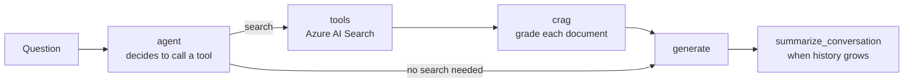

# Health Claims Virtual Assistant

A conversational assistant for the health-insurance provider network: it answers questions about procedure codes (TUSS), SADT forms and claim rules using corrective RAG over the company's reference tables.

**Stack:** Python · LangGraph · LangChain tools · Azure OpenAI · Azure AI Search · Streamlit
**Role:** Lead developer: design and implementation

> Built at a large Brazilian insurer. The company is replaced by the fictional **Acme Seguros**, and every name, document and data point here is fictional. Code, prompts and UI are in Portuguese, written for Brazilian business teams.

## Problem

Clinics and the internal service team asked the same questions every day: which code covers a procedure, which form it needs, what the rule is. Answers lived in long code tables and manuals that are hard to search by meaning.

## What I built

A LangGraph agent with tool calling and a corrective-RAG step:



- **Tool calling:** the model decides when a search is needed instead of searching on every turn.
- **Document grading (CRAG):** each retrieved document is graded as relevant or not, using the question and the conversation history, before generation.
- **Conversation summarisation:** long chats are summarised to keep context and cost bounded.
- **Indexing scripts** (`indexing/`) to build the search indexes from PDFs and code tables, with an index template.

## Run it

```bash
python -m venv .venv && .venv\Scripts\activate   # macOS/Linux: source .venv/bin/activate
pip install -r requirements.txt
cp .env.example .env                               # Azure OpenAI + Azure AI Search
streamlit run streamlit_app.py
```

Answers need a search index with your own procedure-code documents (see `indexing/`).

---
Part of my [AI engineering portfolio](https://github.com/lucasboliveirasipp).
